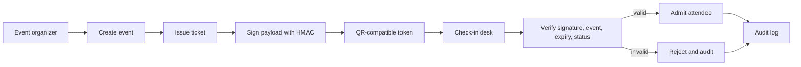

# QR Ticket Validator

A small, dependency-free Python prototype for event ticket generation and check-in validation.

The project models a core workflow used by digital ticketing platforms:

1. create an event
2. issue a signed ticket payload
3. encode that payload into a QR-compatible string
4. validate the ticket at check-in
5. prevent duplicate check-ins
6. keep an audit trail for ticket decisions

It is designed as a public, inspectable example of product-led event-tech architecture rather than a production service.

## Why This Project Exists

Event ticketing platforms need to prove that each ticket is authentic, belongs to the correct event, and has not already been used. A manual process is easy to manipulate; a product-led workflow should verify ticket integrity programmatically.

This prototype demonstrates:

- HMAC-signed ticket payloads
- event-scoped validation
- duplicate check-in prevention
- ticket expiry handling
- capacity tracking
- structured audit logs
- a simple command-line demo

## Architecture



## Repository Structure

```text
qr-ticket-validator/
  src/qr_ticket_validator/
    __init__.py
    audit.py
    cli.py
    models.py
    service.py
    signing.py
  tests/
    test_ticket_service.py
  docs/
    architecture.md
  examples/
    demo.py
  README.md
  pyproject.toml
```

## Quick Start

Run the demo:

```bash
python3 examples/demo.py
```

Run the tests:

```bash
python3 -m unittest discover -s tests
```

Run the CLI:

```bash
python3 -m qr_ticket_validator.cli demo
```

If running the CLI from a fresh checkout, set `PYTHONPATH`:

```bash
PYTHONPATH=src python3 -m qr_ticket_validator.cli demo
```

## Example Output

```text
Issued ticket for Ada Lovelace
First validation: accepted
Second validation: rejected_duplicate_check_in
Tampered validation: rejected_invalid_signature
```

## Core Concepts

### Signed Ticket Payload

Each ticket payload is serialized and signed with HMAC-SHA256. If the payload is changed after issue, signature verification fails.

### Event-Scoped Validation

Tickets are tied to a specific event ID. A valid token for one event cannot be checked into another event.

### Duplicate Check-In Prevention

The validator stores check-in state. Once a ticket has been accepted, a second attempt is rejected.

### Audit Trail

Every validation decision is logged with:

- timestamp
- ticket ID
- event ID
- decision
- reason

## Product-Led Platform Relevance

This project maps to common ticketing platform features:

- automated digital ticket issue
- self-service customer confirmation
- programmatic venue check-in
- fraud/tamper detection
- operational reporting
- event capacity controls

It can be extended into a web API, mobile check-in app, or organiser analytics dashboard.

## Roadmap

- Add FastAPI service wrapper
- Add SQLite persistence
- Add QR image generation
- Add CSV attendee import/export
- Add organiser dashboard mock
- Add payment-confirmed ticket issuance flow

## License

MIT
