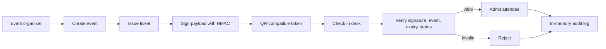

# QR Ticket Validator

An experimental Python prototype for ticket generation and check-in validation, designed for local use with synthetic data. It must not be used to issue tickets or admit attendees at real events.

The project models a core workflow used by digital ticketing platforms:

1. create an event
2. issue a signed ticket payload
3. encode that payload into a QR-compatible string
4. validate the ticket at check-in
5. prevent duplicate check-ins
6. record ticket decisions for inspection

The in-memory demo runs without external services. The PostgreSQL service needs a database.

## What It Demonstrates

This prototype covers:

- HMAC-signed ticket payloads
- event-scoped validation
- duplicate check-in prevention
- ticket expiry handling
- capacity tracking
- structured audit logs
- a simple command-line demo

## Architecture

The following diagram describes the in-memory demo.



## Repository Structure

```text
qr-ticket-validator/
  src/qr_ticket_validator/
    __init__.py
    audit.py
    cli.py
    models.py
    service.py
    postgres.py
    organiser_service.py
    authenticated_organiser.py
    identity.py
    signing.py
    ticket_keys.py
  tests/
    test_ticket_service.py
    test_postgres.py
    test_signing.py
    test_organiser_isolation.py
    test_organiser_operations.py
    test_identity.py
    test_ticket_keys.py
    synthetic_identity_provider.py
  sql/
    001_organiser_isolation.sql
    002_organiser_operations.sql
  docs/
    architecture.md
  examples/
    demo.py
  README.md
  pyproject.toml
```

## Quick Start

Run the demo:

```bash
python3 examples/demo.py
```

Run the tests after installing the project and optional identity dependencies:

```bash
python3 -m pip install -e '.[identity]'
PYTHONPATH=src python3 -m unittest discover -s tests
```

PostgreSQL tests are skipped unless the database settings described below are provided. Identity tests are skipped when the optional dependencies are missing.

Run the CLI:

```bash
python3 -m qr_ticket_validator.cli demo
```

## Example Output

```text
Issued ticket for Ada Lovelace
First validation: accepted
Second validation: rejected_duplicate_check_in
Tampered validation: rejected_invalid_signature
```

## Core Concepts

### Signed Ticket Payload

Each ticket payload is serialised and signed with HMAC-SHA256. If the payload is changed after issue, signature verification fails.

### Event-Scoped Validation

Tickets are tied to a specific event ID. A valid token for one event cannot be checked into another event.

### Duplicate Check-In Prevention

The validator stores check-in state. Once a ticket has been accepted, a second attempt is rejected.

### Audit Trail

The in-memory demo records each returned validation decision with:

- timestamp
- ticket ID
- event ID
- decision
- reason

The PostgreSQL service stores check-in decisions in its database. The organiser service uses a separate audit table; its behaviour is described in `docs/architecture.md`.

## Project Scope

### PostgreSQL service

`PostgresTicketService` stores events, tickets, and check-in decisions in PostgreSQL. Ticket issuance uses a Read Committed transaction and locks the event row before counting issued tickets. Check-in locks the ticket row and checks expiry after acquiring the lock. These protections require every writer to use the same locking rules; direct database writes can bypass them.

Create a dedicated test database, install the project with `pip install -e .`, and set `TEST_DATABASE_URL` to its connection string before running the tests:

```bash
PYTHONPATH=src TEST_DATABASE_URL='postgresql://localhost/ticket_test' python -m unittest discover -s tests
```

The PostgreSQL tests create and alter tables and leave test data in the specified database. Use a disposable test database with no other applications connected. The service creates versioned signed tokens containing event and ticket identifiers; attendee details remain in the database. See `docs/architecture.md` for token format compatibility.

For local tests, generate a random secret with at least 32 bytes of entropy and keep it outside source control. The length check alone cannot establish randomness. The optional `now` argument is for trusted tests, not input from an untrusted client. The service's security boundaries are described in `docs/architecture.md`.

The organiser-isolation experiment uses a separate schema, described in `docs/architecture.md`. To run its tests, set `ORGANISER_TEST_DATABASE_URL` to a dedicated disposable PostgreSQL database named `ridwan_test_*` with a test administrator permitted to create roles. The tests create and remove their own schema and database role; they require that `organiser_stage` does not already exist. An interrupted run may leave test resources behind.

The organiser-scoped operations in `organiser_service.py` use a separate schema. Their test suite uses `OPERATIONS_TEST_DATABASE_URL` pointing to a dedicated disposable `ridwan_test_*` PostgreSQL database with permission to create test roles. It creates and removes its own schema and roles; interrupted runs may leave resources behind. The service trusts the identity supplied by its caller; see `docs/architecture.md` for its security boundary.

The access-token verifier has optional dependencies. Install them with `pip install -e '.[identity]'` to run its tests; otherwise those tests are skipped. An authenticated wrapper maps a verified issuer and subject to an existing user and checks client and scope restrictions before calling the organiser service. Tests use a synthetic in-process issuer with preconfigured public keys. See `docs/architecture.md` for the verifier's scope and identity assumptions.

## Licence

MIT
